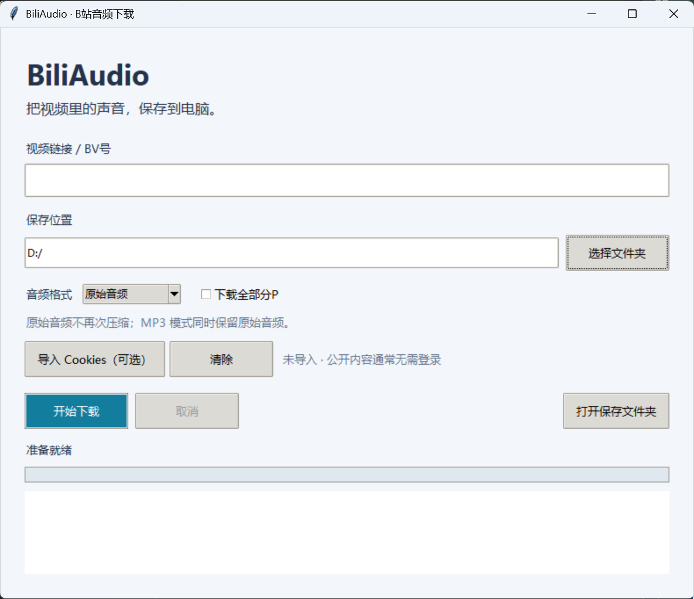

# BiliAudio

一个 Windows 桌面工具，用于下载哔哩哔哩普通投稿视频中的音频，支持保存原始音频或转换为 MP3。

## 下载

👉 [前往发行版页面下载](https://github.com/nAkan0-cn/BiliAudio/releases)

展开对应版本下的 **Assets**，下载 `BiliAudio-Windows.zip`。

解压后双击 `BiliAudio-v1.0.exe` 即可运行，无需安装 Python 或 FFmpeg。

> GitHub 自动生成的 “Source code” 压缩包只包含源码，不是可直接运行的软件。

## 界面预览



## 系统要求

- Windows 10 / Windows 11，64 位
- 可正常访问哔哩哔哩的网络连接

## 功能

- 支持普通视频链接、BV号和 b23.tv 分享链接
- 保存网站提供的原始音频
- 转换为 MP3，同时保留原始音频
- 下载当前分P或全部分P
- 显示下载进度
- 取消下载，并在重新下载时尝试续传
- 可选导入自己的 Netscape 格式 Cookies 文件

## 使用方法

1. 打开软件。
2. 粘贴视频链接、BV号或包含链接的分享文字。
3. 选择保存文件夹。
4. 选择“原始音频”或“MP3”。
5. 如需下载同一投稿的全部分P，勾选“下载全部分P”。
6. 点击“开始下载”。
7. 下载完成后，点击“打开保存文件夹”。

默认保存位置为当前用户的 `Music\BiliAudio` 文件夹。

## 格式说明

- **原始音频**：保存网站提供的独立音轨，通常为 M4A，不再次压缩。
- **MP3**：转换为高质量可变码率 MP3，并保留原始音频文件。

MP3 转换不会提升原音频的音质。

## 常见问题

### 下载失败怎么办？

先确认链接有效，并且可以在浏览器中正常播放。

如果提示需要登录，可以导入自己的 Netscape 格式 `cookies.txt`。请勿上传、分享或提交 Cookies 文件。

遇到站点访问限制或网络错误时，可稍后重试。

### 为什么只下载了一个分P？

默认只下载链接指定的分P；没有指定时下载第一P。需要全部下载时，请勾选“下载全部分P”。

### 为什么 MP3 模式生成了两个文件？

软件会保留下载的原始音频，并另外生成 MP3，这是当前版本的设计。

### 支持所有 B站视频吗？

当前主要支持普通投稿视频。部分内容可能没有可下载的独立音轨，或需要相应的登录和访问权限。

### 为什么 Windows 显示未知发布者？

当前程序未进行代码签名。请核对下载来源，不要忽略明确的恶意软件检测结果。

## 从源码运行

需要 Python 3.11 或更高版本，建议使用 64 位 Python。

在项目根目录执行：

```powershell
python -m venv .venv
.\.venv\Scripts\python.exe -m pip install -r requirements.txt
.\.venv\Scripts\python.exe app.py
```

## 打包

项目提供 `build.ps1` 打包脚本。

当前脚本使用环境中的 `python` 命令安装依赖并运行 PyInstaller。执行前请确认所用 Python 环境正确。

打包成功后，程序位于：

```text
dist/BiliAudio-v1.0.exe
```

## 项目文件

- `app.py`：程序源码
- `requirements.txt`：开发和打包依赖
- `build.ps1`：Windows 打包脚本
- `使用说明.txt`：软件使用说明
- `THIRD-PARTY-LICENSES/`：第三方组件相关说明

## 第三方组件

本项目使用 yt-dlp、FFmpeg、imageio-ffmpeg、PyInstaller 等组件。

第三方组件分别遵循其自身的许可证，详见 `THIRD-PARTY-LICENSES` 文件夹。

FFmpeg 的版本、哈希、许可正文和尚待核实的对应源码材料见
[FFmpeg 分发材料核对](THIRD-PARTY-LICENSES/FFmpeg-AUDIT.md)。
当前记录尚未确认完整对应源码；补充这些文档不代表旧发行包已自动更新或完成全部分发核对。

## 使用范围

仅下载你拥有版权或得到授权保存的内容。软件不绕过付费、会员或其他访问权限限制。

## 许可证

BiliAudio 的项目原创代码采用
[PolyForm Noncommercial License 1.0.0](LICENSE)。

本项目源码公开，可按照许可证条款进行非商业使用、修改和分发。
具体许可范围及例外以 LICENSE 原文为准。

分发时请保留许可证文本或官方链接，以及
[NOTICE](NOTICE) 中的 Required Notice 声明。

yt-dlp、FFmpeg 等第三方组件分别适用各自的许可证，
本项目许可证不替代或限制第三方组件的授权。
相关材料见 [THIRD-PARTY-LICENSES](THIRD-PARTY-LICENSES/)。
